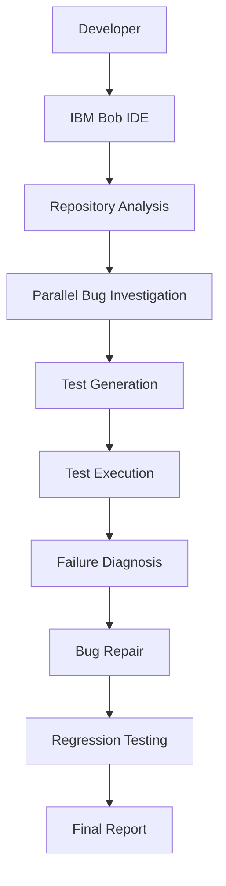

# BobFix — Agentic Bug Detection, Testing & Repair Workflow

A Project showing how **IBM Bob IDE** can carry out an
entire debugging and testing workflow — analyze code, find bugs, generate
tests, run them, diagnose failures, fix bugs, and produce a final report —
instead of a developer doing each step by hand.

## Problem

Manually finding bugs and writing tests for even a small codebase takes real
time: read the code, guess at edge cases, write tests, run them, diagnose any
failures, fix the code, and re-verify nothing broke. It's slow, and it's easy
to under-cover the exact edge cases where bugs actually live — which is
exactly what happened in this repository's initial test suite (see
`reports/final-report.md` after running the workflow).

## Solution

This repository is a small, intentionally-buggy Node.js codebase plus an
initial test suite that only covers the happy paths. **IBM Bob IDE performs
the actual workflow** — analyzing the repo, investigating modules in
parallel, generating tests that expose the seeded bugs, diagnosing each
failure, fixing only genuine defects, and re-verifying the full suite — using
Bob's Agent mode, parallel tasks/subagents, and repository understanding. The
exact prompts to give Bob are in [`BOB_WORKFLOW.md`](./BOB_WORKFLOW.md).

## Architecture



## Installation

```
npm install
```

## Run tests

```
npm test
```

## Run coverage

```
npm run coverage
```

Both commands work on Windows and Linux/WSL with no extra setup.

## Bob workflow

Open this folder in IBM Bob IDE and follow the six steps — with the exact
prompts to give Bob — in [`BOB_WORKFLOW.md`](./BOB_WORKFLOW.md). Each step
maps to a specific Bob capability (Agent mode, parallel tasks/subagents,
test generation, diagnosis, repair, and final reporting).

## Dataset

[`dataset/bug_cases.json`](./dataset/bug_cases.json) is an original dataset
created for this hackathon: 10 bug/test scenarios covering the calculator,
user, and order modules. See [`DATA_SOURCES.md`](./DATA_SOURCES.md) for
details and confirmation that it contains no personal, client, confidential,
or social-media data.

## Impact measurement

Run this simple manual-vs-Bob benchmark yourself and fill in the table below
with real measurements (do not invent numbers):

**Manual workflow:**
1. Start a timer
2. Read `src/calculator.js`, `src/user.js`, `src/order.js`
3. Find bugs by inspection
4. Write tests that expose them
5. Run tests, fix bugs, rerun
6. Stop the timer

**Bob workflow:**
1. Start a timer
2. Give Bob the Step 1–6 prompts from `BOB_WORKFLOW.md`
3. Let Bob analyze, generate tests, diagnose, and fix
4. Stop the timer

| Metric | Manual | Bob |
|---|---|---|
| Time to identify bugs | | |
| Time to write tests | | |
| Number of tests created | | |
| Number of bugs discovered | | |
| Number of bugs fixed | | |
| Test coverage before | 95% stmts / 50% branch | |
| Test coverage after | | |
| Number of manual steps | | |

## Hackathon criteria

See [`HACKATHON_CRITERIA.md`](./HACKATHON_CRITERIA.md) for the full mapping
of this project to each hackathon requirement.

## Evidence

Real IBM Bob IDE task-session screenshots go in
[`docs/bob-sessions/`](./docs/bob-sessions/README.md), one per workflow step,
per the checklist there. No screenshots or Bob outputs in this repository
are fabricated — they are captured from sessions you run yourself.
